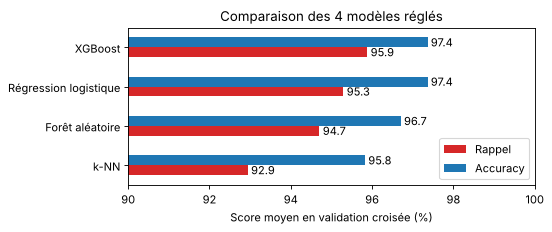
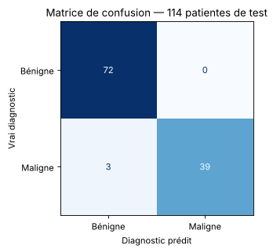
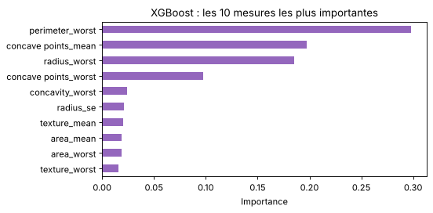

# Détection du cancer du sein par apprentissage supervisé

Modélisation prédictive du caractère bénin ou malin d'une tumeur mammaire à partir de 30 caractéristiques morphologiques des noyaux cellulaires (dataset *Breast Cancer Wisconsin*).

**Résultats clés sur le jeu de test (114 patientes) :**
* **Rappel (Recall) :** 92,9 % (39 cancers détectés sur 42)
* **Accuracy :** 97,4 % (111 / 114)
* **Faux positifs :** 0
* **ROC-AUC :** 0,994

[Consulter le notebook complet](Detection_cancer_du_sein.ipynb)

---

## Contexte et enjeu métier

* **Problématique :** Classification binaire supervisée.
* **Données :** 569 échantillons cliniques, 30 variables quantitatives (rayon, texture, périmètre, aire, concavité, etc.) et un léger déséquilibre des classes (37 % de tumeurs malignes).
* **Choix de la métrique :** En contexte médical, un faux négatif (manquer une tumeur maligne) a des conséquences bien plus critiques qu'un faux positif. Le **Rappel** sur la classe maligne est donc le critère principal, pour l'optimisation des hyperparamètres comme pour le choix du modèle (l'accuracy servant de second critère).

## Méthodologie

1. **Nettoyage :** Suppression de l'identifiant patient et d'une colonne vide ; vérification de l'absence de valeurs manquantes.
2. **Analyse exploratoire (EDA) :** Étude de la distribution des classes, des corrélations inter-variables et des disparités d'échelles entre les mesures.
3. **Préparation des données :** Séparation stratifiée train/test (80 % / 20 %). Standardisation (`StandardScaler`) ajustée uniquement sur le jeu d'entraînement pour éviter toute fuite de données (*data leakage*).
4. **Benchmark de modèles :** Évaluation par validation croisée stratifiée (*5-fold*) de quatre algorithmes : Régression Logistique, k-NN, Random Forest et XGBoost.
5. **Optimisation et évaluation :** Réglage des hyperparamètres via `GridSearchCV` (critère : Rappel), sélection du modèle final avant toute évaluation sur le jeu de test, puis test unique sur les données réservées.

## Résultats

### Comparaison en validation croisée

**XGBoost** (`n_estimators=200`, `max_depth=6`, `learning_rate=0.1`) obtient le meilleur rappel moyen. La régression logistique affiche des performances très proches et constitue une alternative intéressante pour sa forte interprétabilité.

### Performances finales sur le jeu de test

| Métrique | Score | Détail |
| :--- | :---: | :--- |
| **Rappel (Recall)** | **92,9 %** | 39 / 42 tumeurs malignes détectées |
| **Accuracy** | **97,4 %** | 111 / 114 prédictions correctes |
| **Faux positifs** | **0** | Aucune fausse alerte sur les cas bénins |
| **AUC** | **0,994** | Excellente capacité de discrimination |

### Interprétabilité du modèle

Les prédictions reposent principalement sur les dimensions globales de la tumeur (périmètre, rayon) et l'irrégularité de son contour (points concaves), ce qui confirme les observations de l'analyse exploratoire.

## Limites et pistes d'amélioration

* **Ajustement du seuil de décision :** Par défaut fixé à 0,50, ce seuil pourrait être abaissé pour capter davantage de cas positifs (2 des 3 tumeurs malignes manquées présentaient des probabilités prédites de 0,17 et 0,30). Ce réglage devra impérativement être calibré par validation croisée afin de préserver l'intégrité du jeu de test.
* **Taille de l'échantillon :** Avec 569 observations, le modèle nécessiterait une validation sur une cohorte externe plus large avant toute généralisation.
* **Usage :** Ce modèle est conçu comme un outil d'aide à la décision et ne se substitue pas au diagnostic clinique d'un médecin.

## Stack technique

`Python` · `Pandas` · `Scikit-learn` · `XGBoost` · `Matplotlib` · `Seaborn` · `Google Colab`

---
*Projet réalisé par Ndeye Maimouna Badiane — Élève ingénieure en Mathématiques Appliquées et Modélisation (Polytech Lyon).*